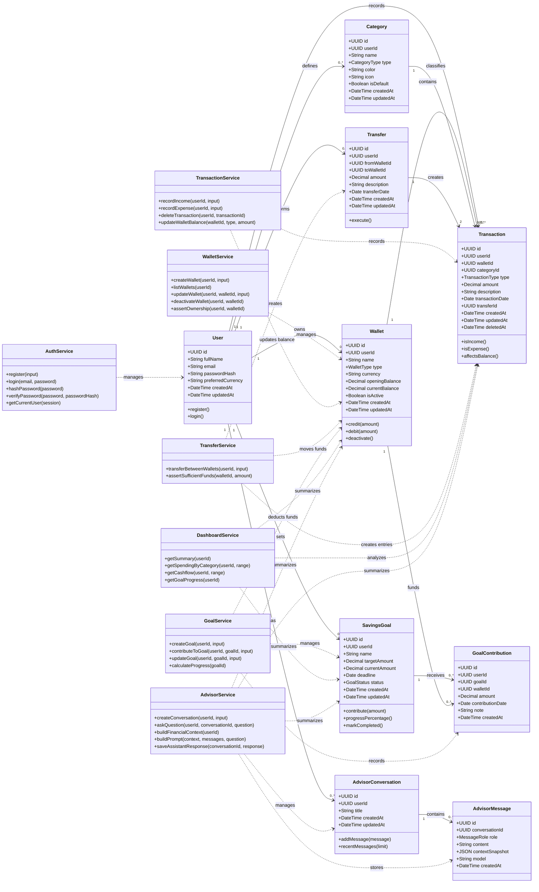

# Class Diagram

This diagram models the main domain classes for the personal finance tracker and AI advisor system. It is intentionally focused on the business model rather than framework details.

## Notes

- The diagram separates domain classes from service classes.
- Domain classes represent persistent business concepts.
- Service classes represent workflows and business rules.
- Controllers are intentionally omitted because they mainly translate HTTP requests into service calls.
- Repositories are also omitted from this first diagram to keep it readable; they will appear in implementation architecture if needed.

## Important Design Choices Reflected

- A `User` owns all private financial records.
- A `Wallet` stores `currentBalance` for version one.
- A `Transaction` affects exactly one wallet.
- A `Transfer` creates two linked transaction entries.
- A `SavingsGoal` receives many `GoalContribution` records.
- `AdvisorConversation` and `AdvisorMessage` preserve AI advisor history.
- `AdvisorService` builds context from trusted stored data rather than relying on client-side summaries.
