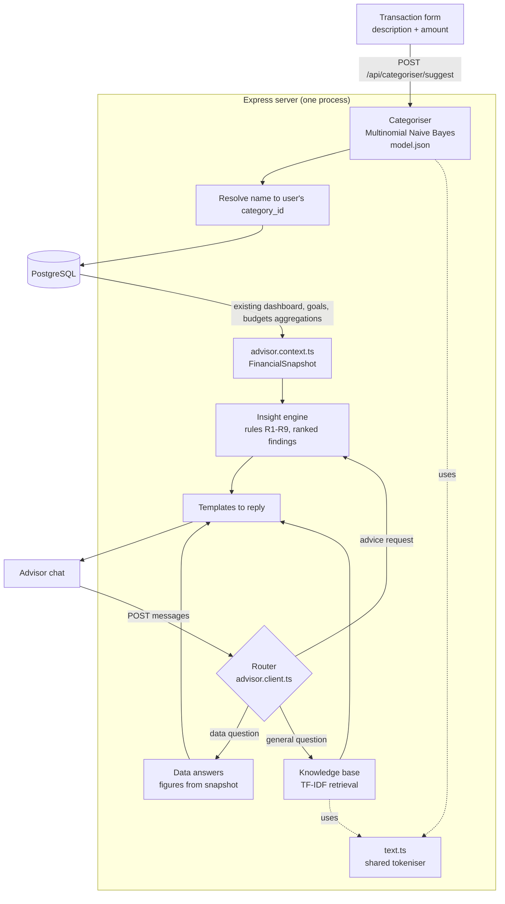
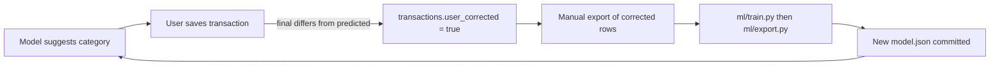

# System Architecture

## Project Goal

Build a web-based personal finance tracker for university students, integrated with a self-hosted, explainable financial advisor. The system should help students record financial activity, understand spending patterns, track savings goals, and receive personalised non-regulated financial guidance based on their own data.

## Architectural Principles

- Keep financial correctness above convenience.
- Separate presentation, API orchestration, business rules, persistence, and the advisor's intelligence.
- Make every user-owned record enforce ownership at the backend.
- Treat wallet transfers and balance-impacting operations as atomic.
- Keep advice grounded in verified system data, not raw user claims alone — every advisor sentence traces to a rule and a number.
- Make no outbound calls: all intelligence (categoriser, insight rules, knowledge base) runs in-process.
- Store enough audit information to debug financial inconsistencies.
- Prefer clear module boundaries over clever abstractions.
- Build vertical slices that can be tested end to end.

## High-Level Deployment Architecture

The application has three runtime parts. There is deliberately no external AI
provider: the advisor's intelligence runs inside the backend (see
[Self-Hosted Intelligence](#self-hosted-intelligence)).

1. Browser client
   - React application.
   - Tailwind CSS for styling.
   - Calls the backend over HTTPS.
   - Stores minimal auth state.

2. Backend API
   - Node.js and Express.
   - Owns authentication, authorization, validation, business rules, analytics queries, transaction categorisation, and advisor replies.
   - Exposes REST endpoints to the frontend.
   - Communicates only with PostgreSQL — no outbound API calls.

3. PostgreSQL database
   - Stores users, wallets, categories, transactions, transfers, savings goals, conversations, and advisor messages.
   - Enforces relational integrity through keys and constraints.
   - Uses migrations for repeatable schema evolution.

## Logical Layers

### Frontend Layer

Responsibilities:

- Render screens and forms.
- Manage client-side route protection.
- Perform basic form validation for user experience.
- Call backend APIs through a typed or centralized API client.
- Display dashboard analytics and advisor messages.

Non-responsibilities:

- Final authorization.
- Financial calculations that affect stored balances.
- Direct database access.
- Direct AI provider access.

### API Layer

Responsibilities:

- Receive HTTP requests.
- Authenticate users.
- Validate request payloads.
- Call service-layer operations.
- Return consistent success and error responses.

Suggested structure:

```text
server/src/
  app.js
  server.js
  config/
  modules/
    auth/
    wallets/
    transactions/
    transfers/
    goals/
    dashboard/
    advisor/
  middleware/
  shared/
```

### Service Layer

Responsibilities:

- Own business rules.
- Coordinate multi-step workflows.
- Start database transactions for atomic operations.
- Prevent cross-user access.
- Prepare context for analytics and AI guidance.

Examples:

- `AuthService.registerUser`
- `WalletService.createWallet`
- `TransactionService.recordExpense`
- `TransferService.transferBetweenWallets`
- `GoalService.contributeToGoal`
- `AdvisorService.askQuestion`

### Repository/Data Access Layer

Responsibilities:

- Contain SQL or ORM queries.
- Keep persistence details out of controllers.
- Return domain-shaped data to services.

Recommended rule:

- Services decide what should happen.
- Repositories decide how data is read or written.

### Intelligence Layer

Responsibilities:

- Suggest a category for a new expense (Naive Bayes model, `categoriser/`).
- Turn the user's aggregates into ranked findings (insight rules, `advisor/insights/`).
- Answer general money questions (TF-IDF knowledge base, `advisor/kb/`).
- Compose replies from findings and answers (router + templates, `advisor.client.ts`).

All of it is pure TypeScript with no I/O of its own: it receives data assembled
by services and returns results, which keeps every component unit-testable.

## Backend Modules

### Auth

Core responsibilities:

- Register users.
- Login users.
- Hash passwords.
- Issue and verify sessions or tokens.
- Protect private routes.

First implementation recommendation:

- Use password hashing with `bcrypt`.
- Use secure HTTP-only cookies or JWT access tokens.
- Keep reset-password as a later enhancement unless required by submission scope.

### Wallets

Core responsibilities:

- Create wallets such as cash, M-PESA, bank, or custom.
- List active wallets.
- Update wallet metadata.
- Deactivate wallets without deleting financial history.
- Expose current wallet balance.

Important rule:

- A wallet belongs to exactly one user. Every wallet operation must check ownership.

### Transactions

Core responsibilities:

- Record income.
- Record expenses.
- Assign categories.
- Update wallet balance or provide balance through a ledger-derived model.
- Support transaction history and filtering.

Important rule:

- A transaction must belong to one wallet and one user.

### Transfers

Core responsibilities:

- Move money from one wallet to another.
- Create a transfer record.
- Create or link the debit and credit transaction entries.
- Ensure both sides succeed or both sides fail.

Important rule:

- Transfers must run inside a database transaction.

### Savings Goals

Core responsibilities:

- Create goals with target amount and optional deadline.
- Track progress.
- Accept contributions.
- Mark goals active, completed, paused, or cancelled.

Important design decision:

- Goal contributions should be represented as financial movements, not just a number edited on the goal.

### Dashboard and Analytics

Core responsibilities:

- Total balances.
- Spending by category.
- Income versus expense trends.
- Recent transactions.
- Savings goal progress.

Important rule:

- Analytics must be computed server-side from trusted persisted data.

### AI Advisor

Core responsibilities:

- Store conversations and messages.
- Build a structured financial snapshot from existing aggregations.
- Generate replies in-process (router → data answers / insight findings / knowledge base → templates).
- Persist assistant responses.
- Apply safety boundaries (disclaimer on loans, debt and investment topics).

Advisor boundaries:

- The advisor provides educational and budgeting guidance.
- It must not claim to provide regulated investment, tax, or legal advice.
- It should explain uncertainty and encourage professional advice for high-stakes decisions.
- It should ground suggestions in user data summaries.

## Self-Hosted Intelligence

The system makes **no outbound API calls**. Every model is trained or written by
the team and runs inside the Express process. This removes the third-party LLM
dependency identified as a risk in the proposal (Limitation 3: availability,
pricing, policy, output variability) and makes every recommendation explainable:
any sentence the advisor produces can be traced to a rule and a number.



### Categoriser

- Multinomial Naive Bayes over unigram + bigram word counts plus one amount-bucket token.
- Trained offline in `ml/` (Python, scikit-learn) on a bootstrap set generated from a hand-built lexicon of Kenyan merchants; evaluated on real, hand-labelled M-Pesa rows that take no part in training or tuning.
- `ml/export.py` writes `server/src/modules/categoriser/model.json` (committed). The server loads it once at startup and scores in pure TypeScript — no Python at runtime.
- A parity test asserts the TypeScript probabilities equal scikit-learn's on sample rows, so the two preprocessing implementations cannot silently drift.
- Confidence of 0.60 or more preselects the category; below that the top three are offered as choices. An unknown merchant (no recognised description term) is capped below the threshold rather than guessed from the amount.

### Insight engine

- Pure rules `(snapshot) => Finding | null` over aggregations the dashboard, goals and budgets modules already compute — no new SQL.
- Rules: category spike vs own 3-month average (R1), category dominance (R2), negative net (R3), low savings rate (R4), goal off pace (R5), budget breach (R6), uncategorised coverage (R7), positive signal (R8), and "not enough data yet" (R9), which suppresses all other analysis.
- The baseline is always the user's own history; there is no cohort.

### Knowledge base

- 49 curated entries (Kenyan student context, KES), vectorised once at startup with TF-IDF.
- Retrieval uses the categoriser's `text.ts` tokeniser — one tokeniser, two consumers.
- Cosine similarity below 0.25 returns nothing, so the advisor says it doesn't know rather than answering an unrelated question.

### Router

`generateReply()` takes the last user message and picks one branch:

| Branch | Triggered by | Answer from |
|---|---|---|
| Advice | "should I", "how can I", "help me", "am I"... | Top findings, ending in exactly one action. A strong topic match ("how do I build an emergency fund?") answers the topic, then ties in the user's top concern. |
| Data | "how much", "show me", "this/last month", a category name... | Figures read directly from the snapshot. |
| General | anything else | Knowledge base, else the top finding, else a statement of what the advisor can do. |

A not-a-licensed-advisor disclaimer is appended whenever the topic touches loans, debt or investment.

### Feedback loop



`predicted_category_id`, `prediction_confidence` and `user_corrected` (migration
009) record every suggestion and whether the user overrode it. Retraining is
deliberately manual: each new model is evaluated against the real hold-out set
before it ships.

### Why no separate Python service

- **One deploy target.** The model is a JSON file inside the API; there is no second service to host, monitor or pay for.
- **No cold start.** Inference is a few hundred additions in-process — no network hop, no container waking up.
- **No cross-service failure mode.** The categoriser cannot be "down" while the API is up; if a suggestion fails, the form simply behaves as it did before.
- Multinomial Naive Bayes over integer counts is a dot product and a softmax, which ports to TypeScript in a few lines. A TF-IDF + logistic regression model was trained for comparison and its accuracy gap is reported in `ml/out/metrics.json`.

## Frontend Routes

Suggested route map:

```text
/                  redirect based on auth
/login             login screen
/register          registration screen
/app               authenticated layout
/app/dashboard     overview and analytics
/app/wallets       wallet list
/app/wallets/:id   wallet details
/app/transactions  transaction history and entry
/app/transfers     wallet transfer flow
/app/goals         savings goals
/app/advisor       AI advisor chat
/app/settings      profile and preferences
```

## API Shape

Initial REST endpoint groups:

```text
POST   /api/auth/register
POST   /api/auth/login
POST   /api/auth/logout
GET    /api/auth/me

GET    /api/wallets
POST   /api/wallets
GET    /api/wallets/:walletId
PATCH  /api/wallets/:walletId
DELETE /api/wallets/:walletId

GET    /api/categories

GET    /api/transactions
POST   /api/transactions
GET    /api/transactions/:transactionId
PATCH  /api/transactions/:transactionId
DELETE /api/transactions/:transactionId

POST   /api/transfers

GET    /api/goals
POST   /api/goals
PATCH  /api/goals/:goalId
POST   /api/goals/:goalId/contributions

GET    /api/dashboard/summary
GET    /api/dashboard/spending-by-category
GET    /api/dashboard/cashflow

POST   /api/categoriser/suggest

GET    /api/advisor/conversations
POST   /api/advisor/conversations
GET    /api/advisor/conversations/:conversationId/messages
POST   /api/advisor/conversations/:conversationId/messages
```

## Recommended Build Order

1. Architecture and database schema.
2. Project scaffold.
3. Authentication vertical slice.
4. Wallet management.
5. Transaction management.
6. Wallet transfers.
7. Savings goals.
8. Dashboard analytics.
9. AI advisor.
10. Deployment, testing evidence, and documentation.

This order is best because every later feature depends on earlier data guarantees. Login needs users. Wallets need users. Transactions need wallets. Transfers need transactions and wallet ownership. Dashboard and AI advisor need reliable financial history.

## Alternatives Considered

### Start with UI/Login Pages

This gives visible progress quickly but risks building screens before the data contracts and backend architecture are clear. It often causes rework when database relationships, auth rules, and API response shapes become clearer later.

### Start with the AI Advisor

This is tempting because it is the most exciting feature, but it depends on financial context from wallets, transactions, categories, and goals. Building it first would force fake data and weak prompt grounding.

### Start with Database Only

This is safer than UI-first, but too isolated. The database should be designed together with use cases and service boundaries so it supports real workflows, not just static entities.

### Recommended Approach: Architecture First, Then Vertical Slices

This balances design discipline with working software. We define the system shape, then implement one complete slice at a time from database to backend to frontend to tests.
